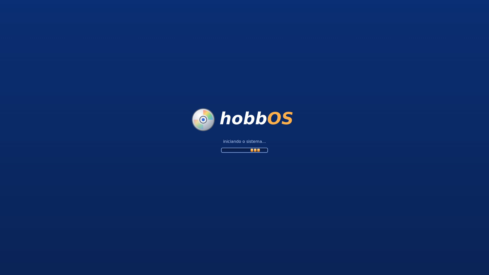
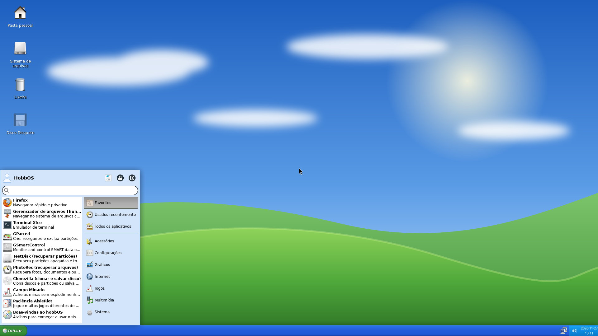
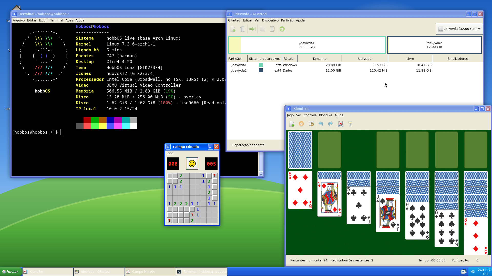

# 💽 hobbOS


[](https://github.com/carriel2/hobbOS/actions/workflows/iso.yml)

O **hobbOS** é uma distribuição Linux customizada (respin) baseada no **Arch Linux**. Nasceu como projeto de estudo sobre como um sistema operacional é montado, e junta a base moderna e rolling-release do Arch com um visual nostálgico dos anos 2000, inspirado no Windows XP.

Ele roda direto do pendrive, sem instalar nada: um sistema live para usar e para resgatar máquinas com problema.


## ✨ O que tem

* **Base Arch, montada com `archiso`**: o perfil fica em [`profile/`](profile/), a partir do `releng` oficial (versão em [`profile/.archiso-base`](profile/.archiso-base)).
* **XFCE leve**, com login automático no usuário live `hobbos` (sem senha, com `sudo`).
* **Visual retrô**: tema de janelas *HobbOS Luna*, ícones nuoveXT2, barra de tarefas azul com o botão **Iniciar**, wallpaper e menu de boot próprios.
* **Cara de anos 2000**:
  * boot animado (Plymouth) com a logo e uma barra de blocos, e som de inicialização próprio;
  * janela de **boas-vindas** com atalhos, e janela **Desligar o computador** com a tela ficando cinza por trás e três botões redondos;
  * **Disquinho**, o mascote (um disquete com carinha), que dá dicas no canto da tela e avisa quando um pendrive é conectado;
  * sons próprios para erro, aviso e pendrive, protetor de tela com efeitos clássicos (canos 3D, labirinto, galáxia) e barra de **Início rápido** ao lado do Iniciar;
  * quatro wallpapers próprios: colina, pôr do sol, lago e noite.
* **Jogos e diversão feitos do zero para o hobbOS**: **Campo Minado** e **Paint** (lápis, pincel, balde, spray, formas, paleta de cores), mais a Paciência (Aisleriot) e um terminal que abre com a logo em ASCII (fastfetch).
* **Em português**: idioma pt_BR, teclado ABNT2 e fuso de Brasília. Firefox em português.
* **Rede e som prontos**: NetworkManager (ícone na bandeja) e PipeWire.
* **Salvar meus arquivos**: assistente que abre o Windows de um PC que não liga **só para leitura** e copia Área de trabalho, Documentos, Imagens, Músicas, Vídeos, Downloads e Favoritos para um HD externo ou pendrive. Funciona do Windows XP ao 11.
* **Relatório do PC**: modelo, processador, memória, vídeo, temperaturas, bateria e a **saúde dos discos (SMART)** com aviso em cores, numa tela só e com opção de salvar em HTML.
* **Kit de resgate** no menu Iniciar: GParted, GSmartControl, TestDisk (recuperar partições), PhotoRec (recuperar arquivos), Clonezilla (clonar e salvar disco), ddrescue, `chntpw` (redefinir senha do Windows), `ntfsfix`, memtest86+ no menu de boot e as ferramentas de terminal do Arch.
* **BIOS e UEFI**.

| Boot | Menu Iniciar |
|---|---|
|  |  |



## 💻 Requisitos para rodar

* Processador **64 bits** (x86_64). O Arch não suporta mais 32 bits, então PCs muito antigos ficam de fora.
* **2 GB de RAM** ou mais.
* **Pendrive de 4 GB** ou DVD: a ISO tem cerca de 1,7 GB, maior que um CD.

**Baixe a ISO** na página de [releases](https://github.com/carriel2/hobbOS/releases) (junto vai o `SHA256SUMS` para conferir o download).

Para gravar no pendrive, no Linux: `sudo dd if=hobbos-*.iso of=/dev/sdX bs=4M status=progress oflag=sync` (troque `sdX` pelo pendrive; **apaga tudo nele**). No Windows, use o [Rufus](https://rufus.ie) em modo DD ou o [Ventoy](https://www.ventoy.net).

### 💾 Guardar arquivos no pendrive (persistência)

Por padrão o hobbOS roda na memória e nada fica gravado. Para guardar arquivos, configurações e programas instalados entre um uso e outro:

1. Grave a ISO no modo DD (dd, Etcher ou Rufus em modo DD) num pendrive maior que a ISO.
2. No hobbOS, abra **Guardar arquivos neste pendrive** no menu Iniciar. Ele cria a partição `HOBBOS_DADOS` no espaço que sobra no fim do pendrive, sem apagar nada.
3. Reinicie e escolha **HobbOS live com persistência** no menu de boot.

Ao gravar uma versão nova da ISO no pendrive, a tabela de partições é reescrita, então a área de persistência precisa ser criada de novo.

## 🛠️ Como gerar a ISO

O `mkarchiso` precisa de um **Arch Linux**. Qualquer máquina Arch serve; este repositório também traz uma VM pronta no OpenStack.

### Em qualquer Arch

```bash
sudo pacman -S --needed archiso git
git clone https://github.com/carriel2/hobbOS.git && cd hobbOS
sudo mkarchiso -v -w /tmp/hobbos-work -o out profile
```

A ISO sai em `out/hobbos-AAAA.MM.DD-x86_64.iso` (cerca de 15 minutos com 4 núcleos).

### Com a VM de build (OpenStack + OpenTofu)

[`infra/`](infra/) sobe uma VM Arch com `archiso`, QEMU e o necessário para os testes, acessível por SSH só a partir dos seus IPs.

```bash
cd infra
cp terraform.tfvars.example terraform.tfvars   # preencha: cloud do clouds.yaml, seu IP, sua chave SSH
tofu init && tofu apply                         # imprime o bloco para o ~/.ssh/config
ssh hobbos-build                                # e na VM: clone o repo e rode o mkarchiso
tofu destroy                                    # quando terminar, libera a quota
```

## ✅ Teste automático

[`tests/smoke-test.sh`](tests/smoke-test.sh) dá boot na ISO no QEMU e, pelo QEMU Guest Agent, confere por dentro do sistema live: desktop no ar, idioma, teclado, fuso, rede e internet, saída de áudio, tema, botão Iniciar, wallpaper, Firefox, ferramentas de resgate, GParted abrindo como root, tela de boot, boas-vindas, jogos, fastfetch, sons, protetor de tela, Disquinho, Paint, Relatório do PC e janela de desligar. Para o **Salvar meus arquivos**, o teste cria um "Windows" falso (disco NTFS com uma conta e as pastas de sempre), conecta um pendrive com o sistema já rodando e confere se os arquivos chegaram nele e se o Windows foi aberto só para leitura. Sai com erro se algo falhar e guarda capturas de tela.

```bash
sudo pacman -S --needed qemu-base edk2-ovmf python dosfstools
tests/smoke-test.sh out/hobbos-*.iso bios
tests/smoke-test.sh out/hobbos-*.iso uefi
```

Com KVM (`/dev/kvm`), cada modo leva uns 4 minutos.

[`tests/persistence-test.sh`](tests/persistence-test.sh) testa a persistência como num pendrive de verdade:
1. copia a ISO para um "pendrive" virtual de 4 GB e dá boot por USB;
2. cria a área de persistência;
3. reinicia pela entrada com persistência e grava um arquivo;
4. reinicia de novo e confere que o arquivo continua lá.

### No GitHub Actions

O workflow [`iso.yml`](.github/workflows/iso.yml) gera a ISO num container Arch e roda o smoke test em BIOS e UEFI (o runner tem KVM). Isso acontece em todo pull request que mexe no perfil. Numa tag `v*`, ele publica a **release** com a ISO e o `SHA256SUMS`.

## 📁 Estrutura

| Pasta | O que tem |
|---|---|
| [`profile/`](profile/) | Perfil archiso: pacotes, configurações do sistema live, boot |
| [`branding/`](branding/) | Arte original em SVG (wallpaper, ícone, menu e animação de boot), o gerador do som de inicialização e `render.sh` para gerar tudo |
| [`tests/`](tests/) | Smoke test no QEMU e `vitrine.sh`, que grava o boot e tira as capturas de divulgação |
| [`infra/`](infra/) | VM de build no OpenStack com OpenTofu |
| [`docs/screenshots/`](docs/screenshots/) | Capturas do sistema rodando no QEMU |

## 🎨 Créditos

* Tema **HobbOS Luna**: derivado do *Windows XP Luna* do [B00merang Project](https://github.com/B00merang-Project/Windows-XP), GPL-3.0 (detalhes em [`NOTICE.md`](profile/airootfs/usr/share/themes/HobbOS-Luna/NOTICE.md)).
* Ícones **nuoveXT2**, do pacote `lxde-icon-theme` do Arch.
* Wallpaper, ícone do Iniciar, telas de boot e som de inicialização (sintetizado em Python, em [`branding/startup-sound.py`](branding/startup-sound.py)): arte original deste projeto.
* Campo Minado, Paint, Disquinho, Salvar meus arquivos, Relatório do PC e as janelas de boas-vindas e de desligar: escritos para o hobbOS, em Python com GTK 3. Os sons do sistema também são sintetizados ([`branding/system-sounds.py`](branding/system-sounds.py)).

O hobbOS não tem relação com a Microsoft. "Windows" e "Windows XP" são marcas da Microsoft; o projeto só se inspira no visual da época e não usa logos nem artes dela.
