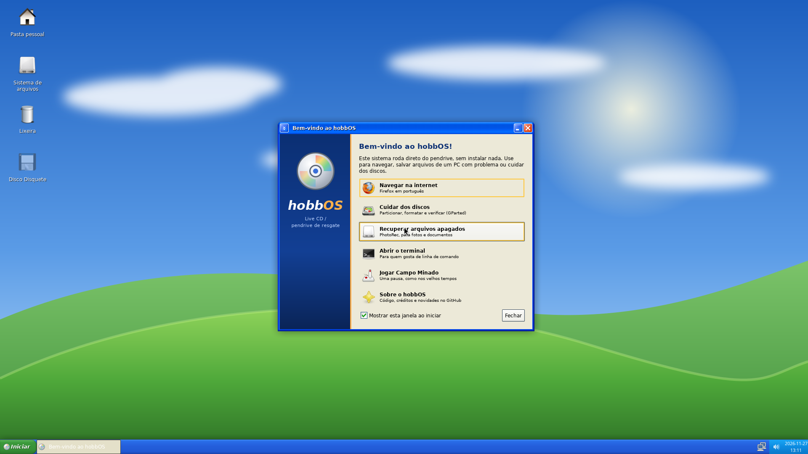
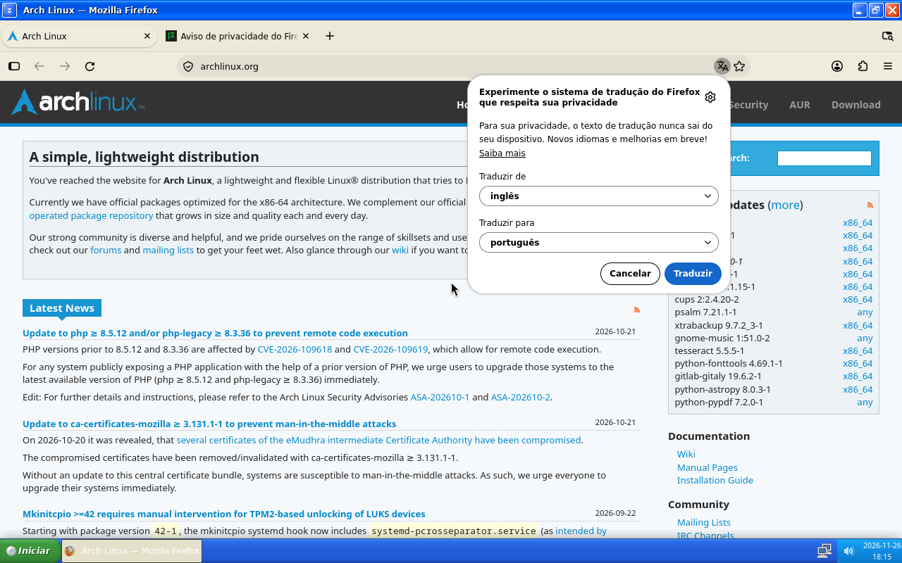
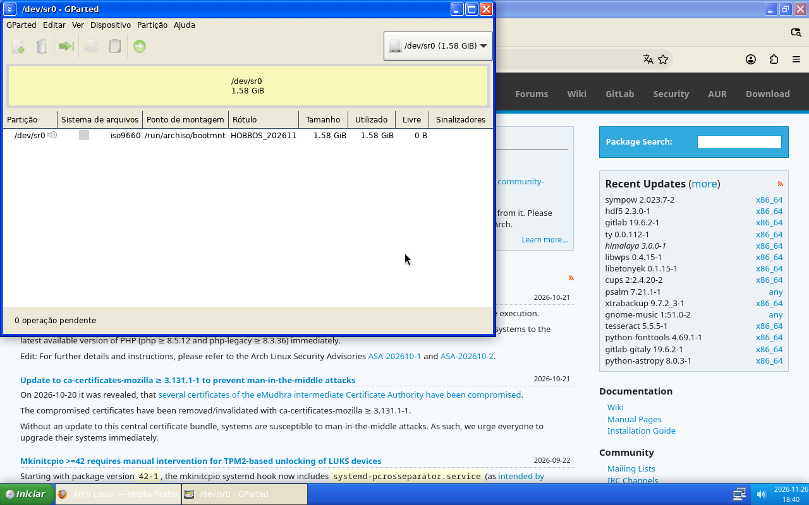

# 💽 hobbOS


O **hobbOS** é uma distribuição Linux customizada (respin) baseada no **Arch Linux**. Nasceu como projeto de estudo sobre como um sistema operacional é montado, e junta a base moderna e rolling-release do Arch com um visual nostálgico dos anos 2000, inspirado no Windows XP.

Ele roda direto do pendrive, sem instalar nada: um sistema live para usar e para resgatar máquinas com problema.



## ✨ O que tem

* **Base Arch, montada com `archiso`**: o perfil fica em [`profile/`](profile/), a partir do `releng` oficial (versão em [`profile/.archiso-base`](profile/.archiso-base)).
* **XFCE leve**, com login automático no usuário live `hobbos` (sem senha, com `sudo`).
* **Visual retrô**: tema de janelas *HobbOS Luna*, ícones nuoveXT2, barra de tarefas azul com o botão **Iniciar**, wallpaper e menu de boot próprios.
* **Cara de anos 2000**: boot animado (Plymouth) com a logo e uma barra de blocos, som de inicialização próprio, janela de **boas-vindas** com atalhos, **Campo Minado** feito do zero para o hobbOS, Paciência (Aisleriot) e terminal que abre com a logo em ASCII (fastfetch).
* **Em português**: idioma pt_BR, teclado ABNT2 e fuso de Brasília. Firefox em português.
* **Rede e som prontos**: NetworkManager (ícone na bandeja) e PipeWire.
* **Kit de resgate** no menu Iniciar: GParted, GSmartControl, TestDisk (recuperar partições), PhotoRec (recuperar arquivos), Clonezilla (clonar e salvar disco), ddrescue, `chntpw` (redefinir senha do Windows), `ntfsfix`, memtest86+ no menu de boot e as ferramentas de terminal do Arch.
* **BIOS e UEFI**.

| Firefox com o tema | GParted |
|---|---|
|  |  |

## 💻 Requisitos para rodar

* Processador **64 bits** (x86_64). O Arch não suporta mais 32 bits, então PCs muito antigos ficam de fora.
* **2 GB de RAM** ou mais.
* **Pendrive de 4 GB** ou DVD: a ISO tem cerca de 1,6 GB, maior que um CD.

Para gravar no pendrive, no Linux: `sudo dd if=hobbos-*.iso of=/dev/sdX bs=4M status=progress oflag=sync` (troque `sdX` pelo pendrive; **apaga tudo nele**). No Windows, use o [Rufus](https://rufus.ie) em modo DD ou o [Ventoy](https://www.ventoy.net).

## 🛠️ Como gerar a ISO

O `mkarchiso` precisa de um **Arch Linux**. Qualquer máquina Arch serve; este repositório também traz uma VM pronta no OpenStack.

### Em qualquer Arch

```bash
sudo pacman -S --needed archiso git
git clone https://github.com/carriel2/hobbOS.git && cd hobbOS
sudo mkarchiso -v -w /tmp/hobbos-work -o out profile
```

A ISO sai em `out/hobbos-AAAA.MM.DD-x86_64.iso` (cerca de 15 minutos com 4 núcleos).

### Com a VM de build (OpenStack + OpenTofu)

[`infra/`](infra/) sobe uma VM Arch com `archiso`, QEMU e o necessário para os testes, acessível por SSH só a partir dos seus IPs.

```bash
cd infra
cp terraform.tfvars.example terraform.tfvars   # preencha: cloud do clouds.yaml, seu IP, sua chave SSH
tofu init && tofu apply                         # imprime o bloco para o ~/.ssh/config
ssh hobbos-build                                # e na VM: clone o repo e rode o mkarchiso
tofu destroy                                    # quando terminar, libera a quota
```

## ✅ Teste automático

[`tests/smoke-test.sh`](tests/smoke-test.sh) dá boot na ISO no QEMU e, pelo QEMU Guest Agent, confere por dentro do sistema live: desktop no ar, idioma, teclado, fuso, rede e internet, saída de áudio, tema, botão Iniciar, wallpaper, Firefox, ferramentas de resgate, GParted abrindo como root, tela de boot, boas-vindas, jogos e fastfetch. Sai com erro se algo falhar e guarda capturas de tela.

```bash
sudo pacman -S --needed qemu-base edk2-ovmf python
tests/smoke-test.sh out/hobbos-*.iso bios
tests/smoke-test.sh out/hobbos-*.iso uefi
```

Com KVM (`/dev/kvm`), cada modo leva uns 3 minutos.

## 📁 Estrutura

| Pasta | O que tem |
|---|---|
| [`profile/`](profile/) | Perfil archiso: pacotes, configurações do sistema live, boot |
| [`branding/`](branding/) | Arte original em SVG (wallpaper, ícone, menu e animação de boot), o gerador do som de inicialização e `render.sh` para gerar tudo |
| [`tests/`](tests/) | Smoke test no QEMU |
| [`infra/`](infra/) | VM de build no OpenStack com OpenTofu |
| [`docs/screenshots/`](docs/screenshots/) | Capturas geradas pelo smoke test |

## 🎨 Créditos

* Tema **HobbOS Luna**: derivado do *Windows XP Luna* do [B00merang Project](https://github.com/B00merang-Project/Windows-XP), GPL-3.0 (detalhes em [`NOTICE.md`](profile/airootfs/usr/share/themes/HobbOS-Luna/NOTICE.md)).
* Ícones **nuoveXT2**, do pacote `lxde-icon-theme` do Arch.
* Wallpaper, ícone do Iniciar, telas de boot e som de inicialização (sintetizado em Python, em [`branding/startup-sound.py`](branding/startup-sound.py)): arte original deste projeto.
* Campo Minado e janela de boas-vindas: escritos para o hobbOS, em Python com GTK 3.

O hobbOS não tem relação com a Microsoft. "Windows" e "Windows XP" são marcas da Microsoft; o projeto só se inspira no visual da época e não usa logos nem artes dela.
